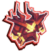
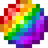
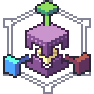
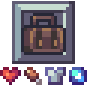
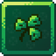
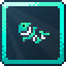

# 🪨 Scaffolding

Scaffolding is a Nexo addon that lets **Bedrock players** on [Geyser](https://geysermc.org/) see your server's custom content.

Nexo builds a Java resource pack for your custom items, blocks, furniture, armor, glyphs and more. Bedrock players cannot see any of it, because Bedrock needs its own format. Scaffolding converts your whole Nexo setup into Geyser mappings and MCPack files that Bedrock understands. It then deploys them to Geyser for you, and converts again every time you change something in Nexo.

MCModels | <a href="https://nexomc.com">NexoMC</a> | Voxel.shop


**Early Access**

Scaffolding is in **early access**. It has been tested a lot and handles most Nexo content, but it can still have bugs. If something looks wrong on Bedrock, report it in our Discord. Include a screenshot and the item, block or furniture it happens with. Your reports help us reach a stable release sooner.


Requirements (click to expand)

<table><thead><tr><th width="229.666748046875">Plugin</th><th width="126.6666259765625">Needed</th><th>Notes</th></tr></thead><tbody><tr><td><a href="https://nexomc.com">Nexo</a> <strong>1.26+</strong></td><td>Required</td><td>Scaffolding is a Nexo addon and converts the pack Nexo builds.</td></tr><tr><td><a href="https://geysermc.org/">Geyser</a> <code>2.11.0-SNAPSHOT</code> +</td><td>Required</td><td>Older Geyser builds are missing the mapping and extension features Scaffolding needs.</td></tr><tr><td><a href="https://geysermc.org/">Floodgate</a></td><td>Optional</td><td>Tells Scaffolding who is a Bedrock player, so text sent to them uses glyph codes that work on Bedrock.</td></tr><tr><td><strong>ScaffoldingExtension</strong></td><td>Optional</td><td>Comes with Scaffolding. You need it for <strong>NexoFurniture and/or ModelEngine</strong>, and when Geyser runs on a <strong>proxy or standalone</strong> (it receives the synced output). It also sends pack changes to Bedrock players without a <code>geyser reload</code>, and runs several of the Java-style UI features.</td></tr></tbody></table>

Your server also needs to reach the internet.\
Scaffolding uploads the pack to a hosted converter service and unpacks the result it gets back. Your game server never does the heavy conversion work itself.

### Setup

How you install Scaffolding depends on where Geyser runs. Pick your setup below.



Nexo, Scaffolding and Geyser all run on the same Paper server.

1. Put `Scaffolding.jar` in `plugins/`, next to Nexo and Geyser-Spigot.
2. Put `ScaffoldingExtension.jar` in `plugins/Geyser-Spigot/extensions/`. This is recommended, see [ScaffoldingExtension](scaffoldingextension.md).
3. Start the server. Scaffolding finds Geyser on its own and puts the mappings in Geyser's `custom_mappings/`. With the extension, the extension sends the pack to Bedrock players. Without it, the pack goes into Geyser's `packs/` folder.
4. **Restart once** so Geyser loads the new mappings.

That's it. Most servers don't need to change any settings.



In this setup Geyser runs on the proxy, and Nexo and Scaffolding run on a backend Paper server.\
Scaffolding sends its output to the proxy's Geyser **automatically**. You don't have to copy any files.

1. Install Nexo, Scaffolding and [Floodgate](https://geysermc.org/wiki/floodgate/setup?platform=proxy-servers) on the **backend Paper server.**\
   Install Geyser and Floodgate for your proxy (Velocity or BungeeCord) on the **proxy**.
2. Set up Floodgate on the backend by following the [Floodgate proxy guide](https://geysermc.org/wiki/floodgate/setup?platform=proxy-servers):
   * Set `auth-type: floodgate` in the proxy Geyser's `config.yml`
   * Set `send-floodgate-data: true` in the proxy Floodgate's `config.yml`
   * Copy `key.pem` from the proxy Floodgate's folder into the backend Floodgate's folder
   * Turn on player info forwarding between the proxy and the backend
3. Put `ScaffoldingExtension.jar` in the proxy Geyser's `extensions/` folder:\
   `plugins/Geyser-Velocity/extensions/` or `plugins/Geyser-BungeeCord/extensions/`.
4. Start everything. After each conversion, Scaffolding sends the output to Geyser through the **players' own Minecraft connection**. You don't need to open ports or share folders.
5. **Restart the proxy once** so Geyser loads the new mappings. Then ask Bedrock players to reconnect.


By default, the data travels through a **Bedrock player who is online**. If nobody is online when a conversion finishes, the next Bedrock player who joins brings it along.\
Run `/scf sync` to send the last output again, and `/scf status` to check whether the proxy's Geyser is up to date.



**Do both servers share a filesystem?** (same machine, Docker volume, network mount)\
Set `sync.type: FOLDER` in the `config.yml` of both the plugin and the extension. Then set `sync.folder` on both sides to the same folder. The output now arrives within seconds, and no player has to be online.



Run Nexo and Scaffolding on **one** server behind the proxy.

The proxy's Geyser shows the converted content of that one server.




Geyser-Standalone runs as a separate program and connects to your server like a Java player.\
The setup works the same way as on a proxy:

1. Install Nexo, Scaffolding and Floodgate on the **Paper server**.\
   Run **Geyser-Standalone** on any machine you like. It does not need its own Floodgate.
2. Connect it to Floodgate by following the [Floodgate standalone guide](https://geysermc.org/wiki/floodgate/setup?platform=standalone):
   * Set `auth-type: floodgate` in Geyser-Standalone's `config.yml`
   * Copy `key.pem` from the Paper server's Floodgate folder into the Geyser-Standalone folder
3. Put `ScaffoldingExtension.jar` in the standalone Geyser's `extensions/` folder.
4. Start everything. The output travels over Geyser's own connection to your server. This works across machines, and you don't need to open extra ports.
5. **Restart the standalone Geyser once** so it loads the new mappings. Then ask Bedrock players to reconnect.

The notes from the proxy tab apply here too. A Bedrock player carries the data, so if nobody is online, the next one to join brings it. `/scf sync` sends the last output again, and you can use `sync.type: FOLDER` if both sides can reach the same folder.




**When do I need a restart?**

With the ScaffoldingExtension, most changes only need Bedrock players to **rejoin**. New textures, models, sounds, glyphs, GUIs and settings show up the next time they join, with no `geyser reload`.\
You only need to **restart** Geyser when the mappings change, for example when you add or remove items or blocks. Geyser only loads mappings when it starts. Until you restart, Bedrock players keep getting the pack that matches the mappings Geyser has loaded.\
After every conversion, Scaffolding tells you which of the two you need.



When Geyser runs on a **proxy** or **standalone**, you must set up Floodgate so the backend knows who is a Bedrock player ([proxy guide](https://geysermc.org/wiki/floodgate/setup?platform=proxy-servers), [standalone guide](https://geysermc.org/wiki/floodgate/setup?platform=standalone)).\
Glyphs and ModelEngine do not work correctly without it.


### Supported

<table><thead><tr><th width="180.6666259765625">Feature</th><th width="112.3333740234375">Status</th><th>Notes</th></tr></thead><tbody><tr><td>Items (2D and 3D)</td><td>✅ Works</td><td>3D models become held Bedrock models with an automatically rendered inventory icon. 2D items become flat sprites.</td></tr><tr><td>Dyeable models and furniture</td><td>✅ Works</td><td>Dyed and tinted models and furniture keep their color on Bedrock.</td></tr><tr><td>Bows, crossbows and tridents</td><td>✅ Works</td><td>Their draw and throw animations are rebuilt for Bedrock.</td></tr><tr><td>Custom blocks</td><td>✅ Works</td><td>All Nexo CustomBlocks (note-block, string, chorus, etc.) become real Bedrock custom blocks, with their sounds. Carpentry blocks probably work too, but are not fully tested yet.</td></tr><tr><td>Armor &#x26; Elytras for Players</td><td>✅ Works</td><td>Custom armor with an equipment texture shows when worn, elytras included. Custom gliders work on any base item.</td></tr><tr><td>Armor for mobs</td><td>✅ Works</td><td>Custom horse armor, wolf armor and llama decor show on Bedrock.</td></tr><tr><td>Glyphs and emotes</td><td>✅ Works *</td><td>Rebuilt as Bedrock glyph sheets, so they show in chat, names and UI. You can set their Bedrock size per glyph or font (<a data-mention href="emotes-and-glyphs.md">emotes-and-glyphs.md</a>).</td></tr><tr><td>Custom sounds</td><td>✅ Works</td><td>Remapped so Bedrock players hear them.</td></tr><tr><td>Custom GUIs</td><td>✅ Works</td><td>A title glyph that draws a custom inventory background is rebuilt automatically (<a data-mention href="./#custom-gui-and-hud">#custom-gui-and-hud</a>).</td></tr><tr><td>Vanilla GUI &#x26; HUD Overrides</td><td>✅ Works</td><td>Replaced vanilla GUIs and HUD elements show on Bedrock.</td></tr><tr><td>Java-style chat, sidebar, tab list and menus</td><td>✅ Works</td><td>Bedrock's chat, scoreboard, tab list, pause menu, boss bars, menus and tooltips are restyled to look like Java (<a data-mention href="java-style-ui.md">java-style-ui.md</a>).</td></tr><tr><td>Player faces</td><td>✅ With extension</td><td>Players' real faces show in the tab list and in MythicHUD and BetterHud heads when Geyser runs on the same server. Player heads with a skin also show that skin in item displays.</td></tr><tr><td>Hex colors and gradients</td><td>✅ Works</td><td>Colored text shows in its real colors on Bedrock (<a data-mention href="hex-colors.md">hex-colors.md</a>).</td></tr><tr><td>NexoFurniture</td><td>✅ With extension</td><td>Requires <a data-mention href="./#scaffoldingextension">#scaffoldingextension</a>.</td></tr></tbody></table>


**\* Glyphs on Bedrock**

Bedrock draws a glyph at the pixel size it was baked at, so **size and sharpness go together.**\
On **Java** you can set a glyph's size separately from its texture resolution.\
So a large texture that Java shows as a small icon can look **blurry** on Bedrock.\
See [Emotes & Glyphs](emotes-and-glyphs.md) to learn how to adjust this per glyph or font in `glyphs.yml`.

Geyser-Velocity and Geyser-Standalone also need Floodgate for glyphs to work.



Bedrock chooses how an item looks once, based on its data. Unlike Java, it can't change the model based on what happens in game.\
So **models that swap based on live state**, for example when you rename an item, do not carry over.


### Third-party plugins

Scaffolding also supports several popular plugins, so Bedrock players get the same content as Java players.

<table><thead><tr><th width="180.6666259765625">Plugin</th><th width="112.3333740234375">Status</th><th>Notes</th></tr></thead><tbody><tr><td> <a href="https://mythiccraft.io/index.php?resources/model-engine%E2%80%94ultimate-entity-model-manager-1-19-4-26-2.1213/">ModelEngine</a></td><td>✅ With extension</td><td>Requires <a data-mention href="./#scaffoldingextension">#scaffoldingextension</a>.</td></tr><tr><td> <a href="https://mcmodels.net/products/13679/mythichud">MythicHUD</a></td><td>✅ Works</td><td>Its HUD elements are rebuilt for Bedrock players.</td></tr><tr><td> <a href="https://mcmodels.net/products/16936/mythic-armors">MythicArmors</a></td><td>✅ Works</td><td>Custom MythicArmors sets show as worn armor on Bedrock.</td></tr><tr><td> <a href="https://www.spigotmc.org/resources/hmccosmetics.100107/">HMCCosmetics</a></td><td>✅ Works</td><td>Bedrock players see hats, backpacks and the wardrobe. The <a data-mention href="./#scaffoldingextension">#scaffoldingextension</a> keeps the wardrobe camera in first person. Support is new, so you may run into small issues. Please report any bugs in our Discord.</td></tr><tr><td> BetterModel</td><td>✅ With extension</td><td>Requires <a data-mention href="./#scaffoldingextension">#scaffoldingextension</a>. Support is new, so you may run into small issues. Please report any bugs in our Discord.</td></tr><tr><td> BetterHud</td><td>✅ Works</td><td>Support is new, so you may run into small issues. Please report any bugs in our Discord.</td></tr><tr><td> <a href="https://voxel.shop/product/2543/customnameplates">CustomNameplates</a></td><td>✅ Works</td><td>Nameplates convert, but chat bubbles do not work on Bedrock.</td></tr><tr><td> <a href="https://voxel.shop/product/2723/customfishing">CustomFishing</a></td><td>✅ Works</td><td>Support is new, so you may run into small issues. Please report any bugs in our Discord.</td></tr><tr><td> LuxDialogues</td><td>✅ Works</td><td>Support is new, so you may run into small issues. Please report any bugs in our Discord.</td></tr><tr><td> <a href="https://www.spigotmc.org/resources/%E2%AD%90tooltips.109912/">Tooltips</a></td><td>✅ Works</td><td>Tooltips are redrawn on Bedrock, themes included. Support is new, so you may run into small issues. Please report any bugs in our Discord.</td></tr></tbody></table>

### Not yet supported

A few Nexo features do not convert yet, or still have known problems on Bedrock:

<table><thead><tr><th width="173">Feature</th><th width="129.0001220703125">Status</th><th>Notes</th></tr></thead><tbody><tr><td>Custom spears</td><td>⚠️ Partial</td><td>Spears look correct on Bedrock, but their animations do not play properly yet.</td></tr><tr><td>Custom paintings</td><td>❌ Not converted</td><td>Bedrock players see vanilla paintings instead.</td></tr></tbody></table>

### Custom GUI & HUD

On Java, a custom screen is usually one of two things. It is either a glyph in a custom inventory's title that draws a GUI background, or a replaced vanilla HUD texture. Scaffolding rebuilds both on Bedrock. It also handles reskinned vanilla container screens.


**Automatic placement is not exact**

Bedrock and Java lay out their screens differently. The automatic placement is **not always pixel-perfect**, and some GUIs can be off by more.\
See [Custom GUIs & HUDs](custom-guis-and-huds.md) for which screens and HUD elements are supported, and how to move or replace a background.


### ScaffoldingExtension

The resource pack alone cannot draw **furniture** and **ModelEngine** models. Scaffolding comes with a Geyser extension that recreates them on Bedrock. Put `ScaffoldingExtension.jar` in Geyser's `extensions/` folder and restart.


Without the ScaffoldingExtension, items, blocks, armor and glyphs still convert and show. But Bedrock players **will not see furniture or ModelEngine models**.


See [#scaffoldingextension](./#scaffoldingextension "mention") for install steps and how furniture and ModelEngine are handled.

### Configuration

The defaults work for almost every server. You can find the config at `plugins/Scaffolding/config.yml`.\
If you have a config from an older version, Scaffolding moves it to this layout on startup and keeps your settings.

<table><thead><tr><th width="198.333251953125">Setting</th><th width="97">Default</th><th>Purpose</th></tr></thead><tbody><tr><td><code>general.autoConvert</code></td><td><code>true</code></td><td>Convert and deploy every time Nexo rebuilds its pack. When off, only <code>/scf reload</code> converts.</td></tr><tr><td><code>general.debug</code></td><td><code>false</code></td><td>Log conversion details and write <code>output/report.json</code>. Turn it on when you report a problem.</td></tr><tr><td><code>general.cacheSize</code></td><td><code>10</code></td><td>How many past conversions to keep on disk. Going back to an earlier setup is then instant. <code>0</code> keeps none.</td></tr><tr><td><code>pack.name</code></td><td><code>Scaffolding</code></td><td>The pack name Bedrock shows. Split packs add their part to the name, for example <code>Scaffolding Glyphs</code>. If you change it, Bedrock players download the pack again.</td></tr><tr><td><code>pack.description</code></td><td><code>Generated by Scaffolding</code></td><td>The text shown under the pack name on Bedrock.</td></tr><tr><td><code>pack.split</code></td><td><code>false</code></td><td>Send one pack per type of content, so a change only re-sends the part that changed. Players can then choose animated, light or static items. Needs the ScaffoldingExtension, see <a data-mention href="scaffoldingextension.md#resource-pack-options">#resource-pack-options</a>.</td></tr><tr><td><code>optimizations.iconSize</code></td><td><code>X64</code></td><td>Size of inventory icons: <code>X16</code>, <code>X32</code>, <code>X64</code> or <code>X128</code>.</td></tr><tr><td><code>optimizations.compression</code></td><td><code>BALANCED</code></td><td>Texture compression: <code>FAST</code> (biggest pack), <code>BALANCED</code>, or <code>MAX</code> (smallest pack, slowest conversion).</td></tr><tr><td><code>optimizations.animatedItems</code></td><td><code>FULL</code></td><td><code>FULL</code> looks best but copies the model once per frame. <code>SIMPLE</code> makes no copies, so pick it if Bedrock players crash when they join. <code>NONE</code> only shows the first frame.</td></tr><tr><td><code>optimizations.soundQuality</code></td><td><code>ORIGINAL</code></td><td><code>ORIGINAL</code>, <code>COMPRESSED</code> or <code>COMPRESSED_MONO</code>. Needs ffmpeg on the converter host. A sound is only replaced if the new one is smaller.</td></tr><tr><td><code>javaStyle.font</code></td><td><code>JAVA</code></td><td><code>JAVA</code> draws Bedrock text in Java's font. <code>BEDROCK_SMALL_CAPS</code> keeps Bedrock's font but fixes small caps. <code>BEDROCK</code> keeps Bedrock's own font.</td></tr><tr><td><code>javaStyle.pauseMenu</code></td><td><code>true</code></td><td>Make the pause menu look like Java's, using the pack's button art. Classic UI only.</td></tr><tr><td><code>javaStyle.hexColors.copies</code></td><td><code>48</code></td><td>How many copies of the font Bedrock gets for exact hex colors (<code>0</code> to <code>62</code>). Most colors only copy the letters they use, so many more colors fit. <code>0</code> turns this off. See <a data-mention href="hex-colors.md">hex-colors.md</a>.</td></tr><tr><td><code>javaStyle.hexColors.onItems</code></td><td><code>false</code></td><td>Also use exact colors in item names and lore. Leave it off if Bedrock players use creative mode.</td></tr><tr><td><code>javaStyle.chat.enabled</code></td><td><code>true</code></td><td>Make Bedrock chat look and fade like Java's.</td></tr><tr><td><code>javaStyle.chat.bottomLeft</code></td><td><code>true</code></td><td>Move chat to the bottom left at Java's size. Classic UI only.</td></tr><tr><td><code>javaStyle.chat.forceFont</code></td><td><code>true</code></td><td>Show chat in Minecraft's default font and size, ignoring each player's own chat font settings.</td></tr><tr><td><code>javaStyle.chat.forceDuration</code></td><td><code>false</code></td><td>Keep chat lines on screen for 10 seconds like Java, ignoring each player's own chat duration.</td></tr><tr><td><code>javaStyle.sidebar.numbers</code></td><td><code>AUTO</code></td><td>The red score numbers. <code>AUTO</code> hides them where Java does (needs the ScaffoldingExtension). <code>HIDE</code> always hides them, <code>SHOW</code> always shows them.</td></tr><tr><td><code>javaStyle.sidebar.rightAlign</code></td><td><code>true</code></td><td>Line up text scores on the right like Java (needs the ScaffoldingExtension). Does nothing with <code>numbers: SHOW</code>.</td></tr><tr><td><code>javaStyle.sidebar.javaBackground</code></td><td><code>false</code></td><td>Draw Java's dark background behind the sidebar.</td></tr><tr><td><code>javaStyle.tabList.enabled</code></td><td><code>true</code></td><td>Let Bedrock players open Java's tab list with <code>/tablist</code>.</td></tr><tr><td><code>javaStyle.tabList.doubleSneak</code></td><td><code>true</code></td><td>Also open it by sneaking twice quickly.</td></tr><tr><td><code>javaStyle.tabList.duration</code></td><td><code>5s</code></td><td>How long it stays open, for example <code>5s</code> or <code>100t</code>. The maximum is <code>60s</code>.</td></tr><tr><td><code>playerFaces.enabled</code></td><td><code>true</code></td><td>Show players' real faces to Bedrock players in the tab list and in MythicHUD or BetterHud heads. Needs the ScaffoldingExtension on this server's Geyser.</td></tr><tr><td><code>playerFaces.max</code></td><td><code>256</code></td><td>How many faces to keep, from <code>1</code> to <code>1024</code>. The faces not seen for the longest time are removed first.</td></tr><tr><td><code>hudOffsets.mythichud / betterhud</code></td><td><code>{}</code></td><td>Move HUD elements up or down on Bedrock, in pixels. Use the layout name or <code>layout/element</code> as the key.</td></tr><tr><td><code>packConversion.vanillaReskins</code></td><td><code>true</code></td><td>Convert the pack's reskins of vanilla items, trims, blocks and menus.</td></tr><tr><td><code>packConversion.vanillaBlockShapes</code></td><td><code>false</code></td><td>Also rebuild vanilla blocks whose shape the pack changes, so Bedrock shows the new shape. This changes every placed block of that type.</td></tr><tr><td><code>javaStyle.weaponPoses</code></td><td><code>true</code></td><td>Give custom shields, bows and crossbows the vanilla pose while blocking or drawing. This replaces Bedrock's player entity file, so turn it off if another Bedrock pack changes player animations.</td></tr><tr><td><code>packConversion.modelBaseItems</code></td><td><code>{}</code></td><td>Base item(s) for <code>item_model</code> ids that Nexo does not own, such as dummy models or items from other plugins. Put the model id in quotes. If several base items share a model, use a list.</td></tr><tr><td><code>displayEntities.blocks</code></td><td><code>SEEN</code></td><td><code>SEEN</code> shows the block displays your server uses as real blocks. <code>ALL</code> does this for every block (about 1.2 MB more). <code>OFF</code> shows them as held block items. Needs the ScaffoldingExtension.</td></tr><tr><td><code>displayEntities.itemContexts</code></td><td><code>true</code></td><td>Item displays use the item's ground, item frame or head model instead of its held model. Each of these models adds one Bedrock item. Needs the ScaffoldingExtension.</td></tr><tr><td><code>models.modelEngine</code></td><td><code>true</code></td><td>Show ModelEngine models to Bedrock players. Turning it off makes the pack smaller, but Bedrock players then see nothing where those models are.</td></tr><tr><td><code>models.betterModel</code></td><td><code>true</code></td><td>The same, for BetterModel models.</td></tr><tr><td><code>sync.type</code></td><td><code>PLUGIN_MESSAGE</code></td><td>How the output reaches a Geyser on another server (proxy or standalone, see Setup). <code>PLUGIN_MESSAGE</code> goes through the players' connection with no ports, <code>FOLDER</code> uses a shared folder, and <code>NONE</code> turns sync off.</td></tr><tr><td><code>sync.folder</code></td><td>blank</td><td>Only for <code>FOLDER</code>. A folder that both this server and Geyser can reach.</td></tr><tr><td><code>sync.serverId</code></td><td>blank</td><td>The name of this server on the shared Geyser. When blank, the server's folder name is used.</td></tr><tr><td><code>converter.channel</code></td><td><code>STABLE</code></td><td>Which hosted converter to use: <code>STABLE</code> or <code>DEV</code>.</td></tr><tr><td><code>converter.timeout</code></td><td><code>10m</code></td><td>How long to wait for a conversion. Accepts values like <code>30s</code>, <code>10m</code> or <code>1h</code>.</td></tr></tbody></table>

Some settings are not in the file, because almost no server needs them. Scaffolding still reads them if you add them yourself:

<table><thead><tr><th width="198.333251953125">Setting</th><th width="97">Default</th><th>Purpose</th></tr></thead><tbody><tr><td><code>converter.url / converter.jar</code></td><td>blank</td><td>Not in the file by default. <code>url</code> points to a converter you host yourself. <code>jar</code> converts on this machine with no upload.</td></tr><tr><td><code>models.modelEnginePartSwaps</code></td><td>blank</td><td>Not in the file by default. Only needed when a plugin swaps a ModelEngine part onto a bone with a different name, for example Scenes putting a <code>hat</code> on <code>left_pant</code>. Write one line per pair: <code>"host_blueprint.host_bone &#x3C;- source_blueprint.source_bone"</code>, and use <code>*</code> for every blueprint. Swaps between bones with the same name are found automatically.</td></tr><tr><td><code>menus.geyserChestWindows</code></td><td><code>false</code></td><td>Not in the file by default. Turn it on if custom chest GUI art sits 1px above the slots on Bedrock.</td></tr><tr><td><code>glyphs.pixelArt</code></td><td><code>true</code></td><td>Not in the file by default. <code>false</code> resizes every glyph to its exact Java height. Settings per glyph or font go in <code>glyphs.yml</code>.</td></tr></tbody></table>

Two optional files sit next to the config. Scaffolding creates them for you, and you only need them for fine-tuning:

<table><thead><tr><th width="200">File</th><th>Purpose</th></tr></thead><tbody><tr><td><code>gui.yml</code></td><td>Settings per GUI for custom inventory backgrounds on Bedrock (<a data-mention href="custom-guis-and-huds.md">custom-guis-and-huds.md</a>).</td></tr><tr><td><code>glyphs.yml</code></td><td>The size each glyph or font is baked at for Bedrock (<a data-mention href="emotes-and-glyphs.md">emotes-and-glyphs.md</a>).</td></tr></tbody></table>

### Commands

The main command is `/scaffolding`. You can also use `/scaffold` or `/scf`.

<table><thead><tr><th width="302.333251953125">Command</th><th>What it does</th></tr></thead><tbody><tr><td><code>/scf help</code></td><td>List the available commands.</td></tr><tr><td><code>/scf reload [-f]</code></td><td>Convert the current Nexo pack again and redeploy it to Geyser (<code>rl</code> also works). Add <code>-f</code> to force a new conversion, even if nothing changed.</td></tr><tr><td><code>/scf status</code></td><td>Show the converter service, the last output pack and the sync target, and check that both can be reached.</td></tr><tr><td><code>/scf sync</code></td><td>Send the last converted output to the remote Geyser again (see <code>sync.type</code>). Useful after you wipe or move the proxy's Geyser folders.</td></tr><tr><td><code>/scf gui list</code></td><td>List the GUI overlays set up in <code>gui.yml</code>.</td></tr><tr><td><code>/scf gui import &#x3C;glyph> [screen]</code></td><td>Add a glyph to <code>gui.yml</code> as an overlay and convert again. The screen is <code>container</code> if you leave it out.</td></tr><tr><td><code>/scf glyph &#x3C;glyph></code></td><td>Show how a Nexo glyph is baked for Bedrock: its source art, its <code>glyphs.yml</code> entries and the baked size.</td></tr><tr><td><code>/scf tab [player]</code></td><td>Open or close the Java tab list for a Bedrock player, or for yourself if you leave out the player. Players can use <code>/tablist</code> or sneak twice.</td></tr><tr><td><code>/scf cache list</code> / <code>clear</code></td><td>Show or clear the conversion cache on disk.</td></tr></tbody></table>
