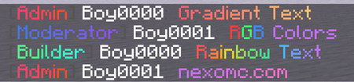

# 🌈 Hex Colors & Color Packs

On Java, text can use any hex color, and a gradient is just many hex colors in a row. Bedrock text can only use a short, fixed list of color codes. So normally every hex color gets rounded to the nearest code on that list, and gradients turn into blocky stripes.

Scaffolding fixes this for you in two ways:

1. **Exact colors for the colors your server uses.** Scaffolding notices which hex colors your server sends to Bedrock players. For those colors it makes letters that are already colored in, and adds them to the pack. Bedrock players then see those colors exactly as on Java.
2. **The closest match for every other color.** Any other color is replaced by the closest of Bedrock's 28 color codes, picked by how similar the colors look to the eye. This is closer than Geyser's own rounding, which only uses the 16 classic colors.

This works for chat, scoreboards, the tab list, boss bars, titles, menu titles, holograms and HUD text (MythicHUD included). It is on by default, and most servers do not need to change anything.

<figure><figcaption>
Gradients and hex colors in Bedrock chat
</figcaption></figure>

### How it learns your colors

You do not need to list your colors anywhere.

* While Bedrock players are online, Scaffolding keeps track of which hex colors appear in their text, and which letters use each color.
* The most used colors get pre-colored letters. If a color only ever appears on a few letters (a rank tag, for example), only those letters are made for it. This is why far more colors fit than the setting below suggests.
* A color that shows up once and never again is ignored, so a one-off message does not take up space.

On a brand new server, Bedrock players first see the closest-match colors. The exact colors appear over time, as players see them.

### Color packs

With the [ScaffoldingExtension](scaffoldingextension.md) installed, the pre-colored letters go into a small **separate color pack**, next to the normal Scaffolding pack:

* When Scaffolding learns new colors, it updates the color pack on its own. You do not need to run a conversion or `geyser reload`.
* Bedrock players get the new colors the **next time they join**.
* Each player only gets colors that their own copy of the color pack has. So a player who still has an older color pack never sees broken letters.

Without the extension, the pre-colored letters go into the main Scaffolding pack instead. Newly learned colors then arrive with the next conversion.


**Geyser on a proxy or standalone**

Exact colors work here too. The color pack reaches the proxy's Geyser the same way the rest of the conversion does (see `sync.type`).\
If you have several servers behind one proxy, one server makes the colors for all of them: the server whose pack the proxy's Geyser serves. The other servers use its colors and send it the colors they use. Those colors also become exact for everyone after a rejoin.


### Settings

In `plugins/Scaffolding/config.yml`:

<table><thead><tr><th width="250">Setting</th><th width="90">Default</th><th>What it does</th></tr></thead><tbody><tr><td><code>javaStyle.hexColors.copies</code></td><td><code>48</code></td><td>How many font copies Bedrock gets for exact colors, <code>0</code> to <code>62</code>. A color only copies the letters it uses, so far more than 48 colors fit. <code>0</code> turns exact colors off.</td></tr><tr><td><code>javaStyle.hexColors.onItems</code></td><td><code>false</code></td><td>Also color item names and lore exactly. Leave it off if Bedrock players use creative mode, since creative saves the colored letters into the items.</td></tr></tbody></table>

Your text font setting (`javaStyle.font`) applies to colored text too. See [Java-style UI on Bedrock](java-style-ui.md#java-font).

### Good to know

* **Lines with other scripts.** If a line also has letters outside the Latin alphabet (Chinese, Cyrillic, some symbols), Bedrock draws the whole line with its own glyph sheets. Scaffolding then uses the closest-match colors for that line, so the text does not end up in two different sizes.
* **New words can take a little while.** A word only uses exact colors once every letter in it has one, because Bedrock spaces exact and plain letters differently. Until then the word shows in closest-match colors. Scaffolding learns the missing letters, and the word turns exact once the color pack has updated and players rejoin.
* **Bold text** gets its own pre-colored letters, so bold colored text stays bold.
