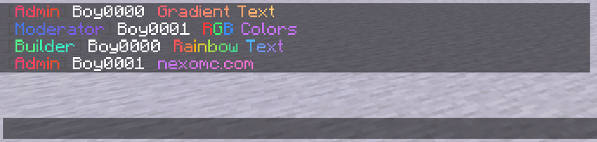
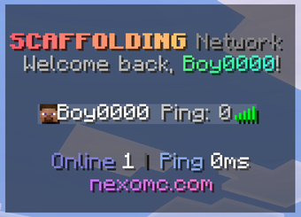
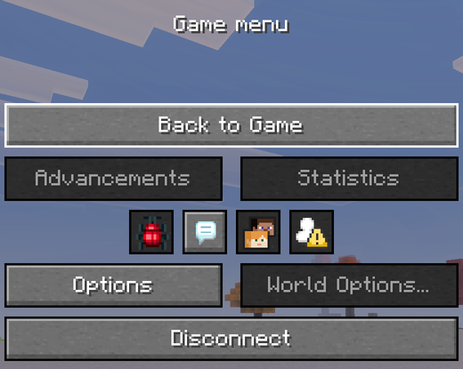

# 🎨 Java-style UI on Bedrock

Bedrock draws chat, the sidebar, boss bars and menus in its own style. A server that looks right on Java can look wrong on Bedrock.\
Scaffolding restyles these parts of the Bedrock screen so they look like Java. Everything is **on by default**. You can turn off or adjust each part in `plugins/Scaffolding/config.yml`.


Some parts need the [ScaffoldingExtension](scaffoldingextension.md), because they react to what the server sends while players are online.\
Those parts are marked **Needs the extension** below. Everything else comes from the converted pack and works without it.



After you change any of these settings, run `/scf reload -f`. Bedrock players see the change the next time they join.


### Java font

Bedrock players see text in **Java's font**, so chat, item names, scoreboards and menus look the same on both editions. Accented letters stay full size too.

<table><thead><tr><th width="260"><code>javaStyle.font</code></th><th>What Bedrock players see</th></tr></thead><tbody><tr><td><code>JAVA</code> (default)</td><td>Java's font everywhere.</td></tr><tr><td><code>BEDROCK_SMALL_CAPS</code></td><td>Bedrock's own font, but small caps stay small caps instead of turning into capitals.</td></tr><tr><td><code>BEDROCK</code></td><td>Bedrock's own font, with no changes.</td></tr></tbody></table>

### Colored text

Bedrock players see hex colors and gradients in their real colors. They are not rounded to the nearest of the 16 classic colors. See [Hex Colors & Color Packs](hex-colors.md) for details.

### Chat

Bedrock chat **looks and behaves like Java chat**:

* Messages appear in the bottom left at Java's size, in Java's font, and fade out like on Java.
* When a player opens chat, the input bar, command suggestions and message history look like Java's too.

<table><thead><tr><th width="260">Setting</th><th width="120">Default</th><th>What it does</th></tr></thead><tbody><tr><td><code>javaStyle.chat.enabled</code></td><td><code>true</code></td><td>Turns the whole chat restyle on or off.</td></tr><tr><td><code>javaStyle.chat.bottomLeft</code></td><td><code>true</code></td><td>Moves chat to the bottom left at Java's size, on the classic UI only. Turn it off if a HUD sits there.</td></tr><tr><td><code>javaStyle.chat.forceFont</code></td><td><code>true</code></td><td>Uses Minecraft's default chat font and size, whatever the player picked.</td></tr><tr><td><code>javaStyle.chat.forceDuration</code></td><td><code>false</code></td><td>Keeps chat messages on screen for 10 seconds like Java, whatever the player picked.</td></tr></tbody></table>

<figure><figcaption>
Bedrock chat opened, with Java placement, font and colors
</figcaption></figure>

### Sidebar (scoreboard)

The sidebar **looks like Java's**:

* Lines and the title are as wide as on Java. They are not cut off.
* The red score numbers are hidden on boards where Java hides them. This means boards with blank or text scores, which most scoreboard plugins use.
* Text scores line up in a column on the right like on Java. They are not stuck to the end of the line.
* Animated boards (TAB, AnimatedScoreboard and similar) update smoothly without stuttering, because the whole board redraws at once.

<table><thead><tr><th width="260">Setting</th><th width="120">Default</th><th>What it does</th></tr></thead><tbody><tr><td><code>javaStyle.sidebar.numbers</code></td><td><code>AUTO</code></td><td><code>AUTO</code> hides the red numbers where Java does (<strong>needs the extension</strong>). <code>HIDE</code> always hides them. <code>SHOW</code> always shows them.</td></tr><tr><td><code>javaStyle.sidebar.rightAlign</code></td><td><code>true</code></td><td>Lines up text scores on the right like Java (<strong>needs the extension</strong>). Does nothing with <code>numbers: SHOW</code>.</td></tr><tr><td><code>javaStyle.sidebar.javaBackground</code></td><td><code>false</code></td><td>Draws Java's dark background behind the sidebar. Off uses each player's own opacity setting.</td></tr></tbody></table>

The extension has matching settings under `sidebar:` in its own `config.yml`, for example how often animated boards may redraw. The defaults work for almost every server.

### Tab list

Bedrock has no tab key. Scaffolding gives Bedrock players **Java's tab list** as an overlay instead, with your header, footer, ranks, teams, ping and separator lines.\
With the extension, each player shows with their real face. You can turn faces off with `playerFaces.enabled`.

Bedrock players can open it by:

* sneaking twice quickly,
* typing `/tablist`,
* or you can show it to someone with `/scf tab <player>`.

<table><thead><tr><th width="260">Setting</th><th width="120">Default</th><th>What it does</th></tr></thead><tbody><tr><td><code>javaStyle.tabList.enabled</code></td><td><code>true</code></td><td>Turns the overlay and <code>/tablist</code> on or off.</td></tr><tr><td><code>javaStyle.tabList.doubleSneak</code></td><td><code>true</code></td><td>Also opens it when a player sneaks twice quickly.</td></tr><tr><td><code>javaStyle.tabList.duration</code></td><td><code>5s</code></td><td>How long it stays open, for example <code>5s</code> or <code>100t</code>. The maximum is <code>60s</code>.</td></tr></tbody></table>

**Needs the extension:** Bedrock's own player list (in the pause menu) also shows the names from your Java tab list, with their ranks, prefixes and colors. Without it, players see plain usernames. Turn it on or off with `tabListNames` in the extension's `config.yml`.

<figure><figcaption>
The Java tab list on Bedrock, with the player's real face
</figcaption></figure>

### Pause menu

The pause menu **looks like Java's**. It has the same buttons as your server's Java menu, uses the button art from your pack, and shows any button text your pack's language files change.\
This only works on Bedrock's classic UI. On the pocket UI, players keep Bedrock's own menu. Turn it off with `javaStyle.pauseMenu`.

<figure><figcaption>
The pause menu laid out like the server's Java menu
</figcaption></figure>

### Boss bars

Custom boss bar art from your pack shows on Bedrock **in the right color and in the right place**:

* White bars stay white. They do not turn purple.
* When a plugin sends a bar again, it keeps its row and does not slide down.
* Empty bars, which some plugins use as spacers, no longer push the real bars down the screen.

### Container menus

Chests, barrels and other menus look closer to Java:

* Menus with 1, 2, 4 and 5 rows fit properly, also on phones.
* Menu titles use Java's title color.
* If your pack reskins the hopper, dispenser, dropper or crafter menu, Bedrock players see that reskin too.

For custom GUI backgrounds made with glyphs, see [Custom GUIs & HUDs](custom-guis-and-huds.md).

### Item tooltips

**Needs the extension.** Items with a custom `tooltip_style` show **their custom tooltip frame** on Bedrock too, instead of Bedrock's default box. Turn it on or off with `tooltipStyles` in the extension's `config.yml`.

### Holograms and nameplates

**Needs the extension.** Hologram lines from plugins like DecentHolograms, HolographicDisplays or CMI look the way they do on Java, without Bedrock's dark nametag background. Turn it on or off with `holograms` in the extension's `config.yml`.
